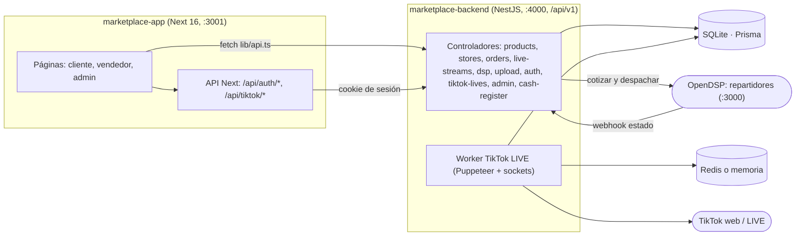
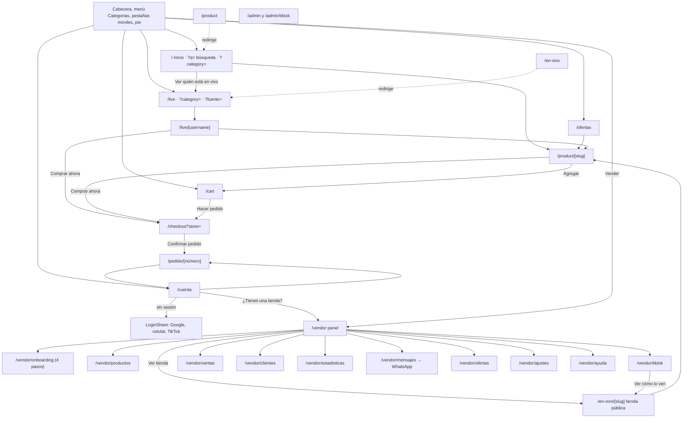
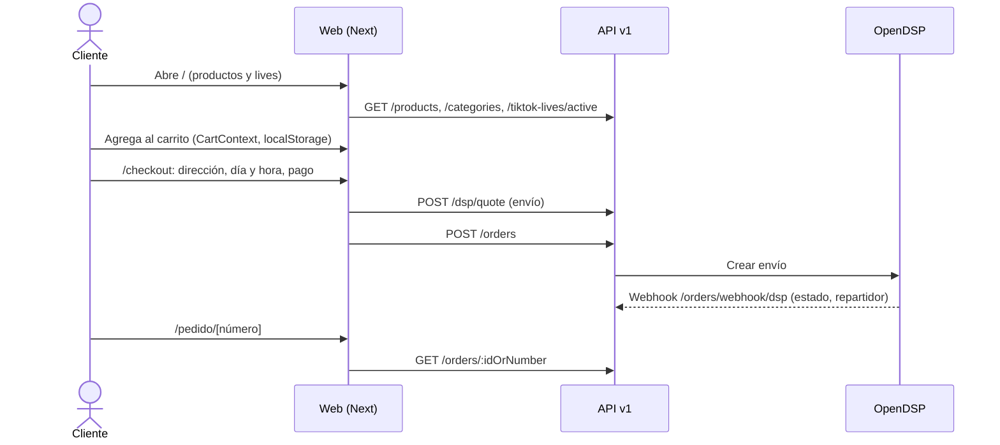
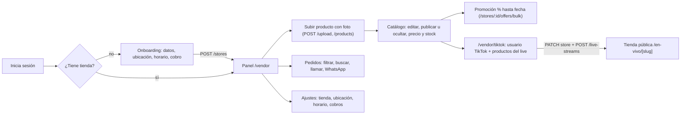
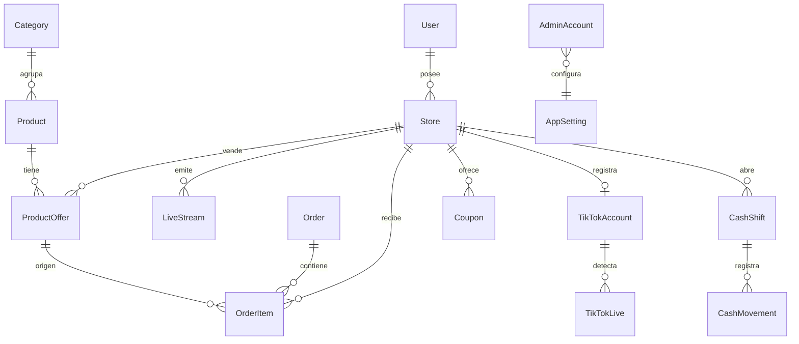

# Vitrina Market — mapa de funcionamiento

Auditado el 2026-10-29 sobre `marketplace-app` (Next 16) + `marketplace-backend` (NestJS + Prisma/SQLite). Los datos de pruebas se crearon en una copia aislada de la base, no en la real.

## 1. Arquitectura

## 2. Mapa de rutas y navegación

## 3. Recorrido del cliente

## 4. Recorrido del vendedor

## 5. Datos (Prisma)

## 6. Estado verificado

| Área | Estado | Cómo se comprobó |
| --- | --- | --- |
| Enlaces y botones (todos los `href`, `router.push`, `<button>`) | Sin enlaces rotos ni botones sin acción | Escaneo estático + clic en vivo |
| Cliente: inicio, búsqueda, categorías, producto, carrito, checkout, pedido, cuenta | Funciona | Compra real en base aislada |
| Ofertas | Funciona (aparece en `/ofertas`, producto y listado) | Promoción creada y terminada |
| Lives de TikTok (`/live`, `/live/[user]`) | Funciona con video, chat, pestañas, sonido | API real, 43 lives |
| Vendedor: onboarding, productos, ajustes, TikTok, pedidos, promociones | Funciona | Tienda registrada en base aislada |
| Copiar enlace de tienda | Con respaldo nuevo; no se pudo confirmar en el navegador embebido | — |
| OAuth Google/TikTok, WhatsApp, Redis, Docker | No comprobado | Faltan llaves y servicios |

## 7. Brechas encontradas

1. **Admin sin autenticación.** `/admin` abre sin login y `GET/PATCH/DELETE /api/v1/admin/*` no tienen guardia: cualquiera puede banear tiendas. (En el repo ya aparecen `AdminAccount` y `admin-auth.controller.ts`, trabajo en curso.)
2. **Cifras inventadas en admin.** `admin.service.ts` suma `+1420` usuarios, `+840` pedidos y `+154200` al volumen; `AdminControlCenter` muestra “1425 usuarios” y “Bs. 154.200”.
3. **Acceso por celular sin código.** `LoginSheet` → “Usar mi número de celular” → “Entrar” no verifica nada; se puede entrar con cualquier número. Hay `OtpCode` en el esquema, aún sin conectar.
4. **Google y TikTok en modo demo** hasta configurar llaves (el propio sheet lo indica).
5. **El vendedor no puede cambiar el estado de un pedido** (`PATCH /orders/:id/status` existe, sin botón) ni borrar un producto (`DELETE /products/:id` existe, sin botón). `cash-register` no tiene pantalla.
6. **`/vendor/tiktok` afirma “Estás en vivo en Vitrina”** al guardar, sin comprobar que el live exista en TikTok (contradice `TIKTOK_SELLER_FLOW.md`).
7. **Al terminar el live** el campo de usuario de TikTok queda vacío aunque se había guardado.
8. Avatares de clientes vienen de `api.dicebear.com` (servicio externo).
